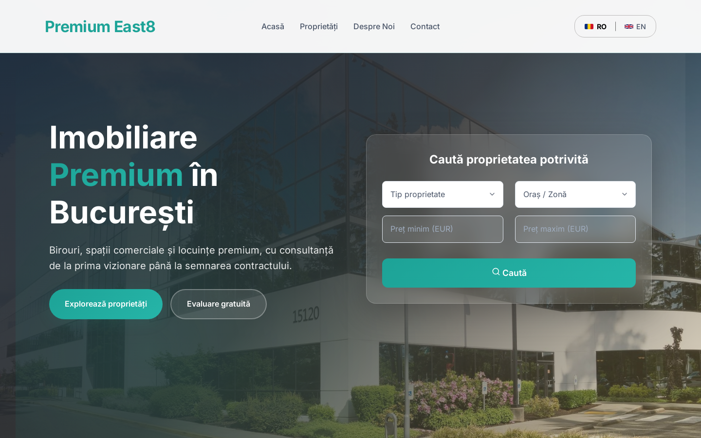
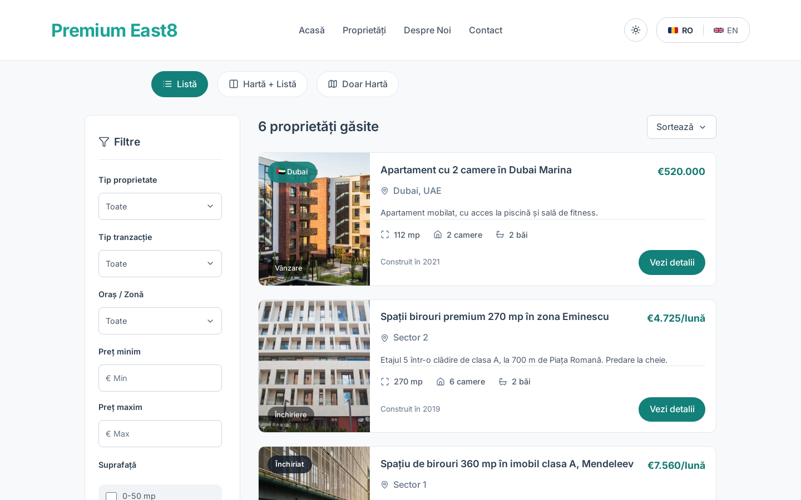
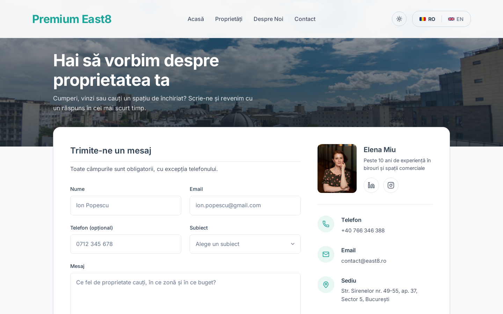

# East Eight

Website for Premium East8, a Bucharest real estate agency that works mostly with office and retail space and has started listing properties in Dubai. The site is in Romanian, with an English toggle for the main navigation and the About page.



| Listings | Contact |
| --- | --- |
|  |  |

## Features

- Listings page with filters for property type, transaction type, city and neighbourhood, price, surface, rooms and year built. Filters live in the URL, so a filtered search can be bookmarked or shared.
- List, map and split views. The map uses Mapbox GL and is loaded only when one of the map views is opened, which keeps the main bundle around 380 KB.
- Property page with a photo grid, a fullscreen gallery (keyboard arrows, Escape, scroll-to-zoom), a location map and a link that opens the contact form with the property already filled in.
- Sold and rented listings stay visible with a status badge.
- Contact form sent through Formspree, with a GDPR consent checkbox and a privacy and terms page.
- Romanian and English translations with i18next.
- Light and dark themes. The site follows the system setting until the visitor picks one with the switch in the header, and the choice is saved in `localStorage`. An inline script in `index.html` sets the theme before the first paint, so there's no flash on load. Maps switch to a dark Mapbox style as well.

## Stack

React 19, React Router 7, Vite, Supabase (Postgres) for listings, Mapbox GL, Formspree, i18next, lucide-react.

## Running locally

```bash
npm install
npm run dev
```

The site runs without any configuration. If Supabase isn't set up, it reads the sample listings in `src/data/sampleProperties.js`. The three Bucharest offices there are real listings from east8.ro; the Dubai ones are placeholders.

To connect the real services, copy `.env.example` to `.env` and fill in the keys you need:

| Variable | Used for |
| --- | --- |
| `VITE_SUPABASE_URL`, `VITE_SUPABASE_PUBLISHABLE_DEFAULT_KEY` | Reading listings from the `properties` table |
| `VITE_MAPBOX_TOKEN` | Map views on the listings and property pages |
| `VITE_FORMSPREE_FORM_ID` | Contact form submissions |

## Project structure

```
src/
  components/   Header, footer, cards, map, gallery, dropdown
  pages/        Home, listings, property details, about, contact, privacy
  lib/          Supabase client and listing queries (with the local fallback)
  data/         Filter options, agency details, sample listings
public/
  listings/     Photos for the sample listings
  locales/      Translation files
```

## Deployment

`vercel.json` rewrites every route to `index.html`, so client-side routes work on Vercel. Add the same environment variables in the Vercel project settings.
